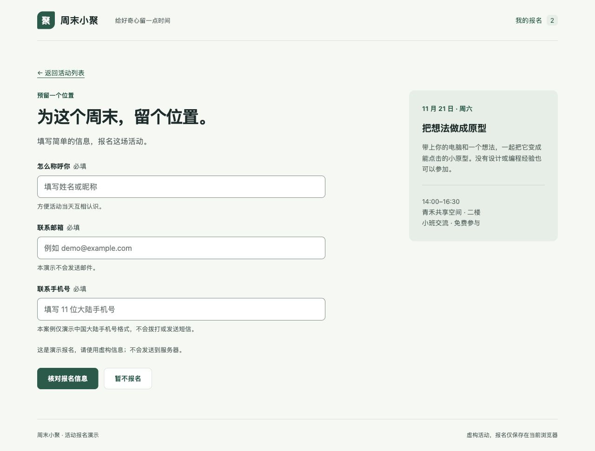

# 完整案例：活动报名原型

文档修订时间：2026-11-10 13:23:01（Asia/Shanghai）。

用同一个原型演示两个 skill：先把单文件拆成职责清楚的静态应用，再增加一个必填手机号字段，保留已有报名数据。

两个 skill 面向支持 `SKILL.md` 的工具；以下提示词使用普通技能名称，安装和调用方式见 [README](README.md#安装)。

## 从这里开始

- [案例说明与复现提示词](examples/event-registration/CASE-STUDY_20261110-132301.md)
- [三个版本的本地体验入口](examples/event-registration/index.html)
- [运行与维护说明](examples/event-registration/README-prototype_20261109-184615.md)
- [需求到文件的 CHANGE-MAP](examples/event-registration/CHANGE-MAP_20261109-184615.md)
- [实际验证记录](examples/event-registration/VALIDATION_20261109-184615.md)
- [新增手机号的两文件差异](examples/event-registration/phone-field_20261109-175441.patch)

GitHub 的 HTML 文件页显示源码。要实际操作，点击仓库的 **Code → Download ZIP**，解压后用浏览器打开 `examples/event-registration/index.html`。不需要安装依赖。

## 对照关系

| 阶段 | 入口/源码 | 变化 |
| --- | --- | --- |
| 原始单文件 | [before](examples/event-registration/before/index.html) | 一个 HTML，内联样式与脚本 |
| static-prototype-splitter | [after-split](examples/event-registration/after-split/) | 8 个文件，原始界面与功能保持一致 |
| prototype-maintenance | [after-change](examples/event-registration/after-change/) | 新增必填手机号，仅两个 JS 文件有功能差异 |

这是独立构造的教学样例，活动与演示数据均为虚构。代码使用本地存储，不连接后端。跨版本的存储共享受浏览器文件模式限制；说明中包含可选的本机 HTTP 预览方法。

原有两份 skill 的介绍、安装和使用说明仍见 [README](README.md)。本案例沿用仓库的 [MIT 许可证](LICENSE)。

已完成本机 HTTP 浏览器验收：姓名/邮箱与手机号校验、取消与 Escape、保存后刷新、旧记录兼容、重复点击、浏览器前进后退、390 px 窄屏布局。详见验证记录。

