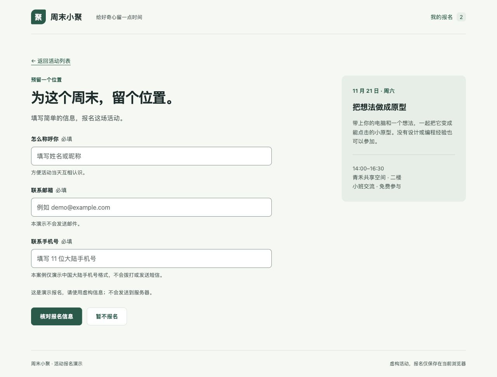

# Prototype Skills

面向支持 `SKILL.md` 的 AI Agent 的两个通用技能：拆分已有 HTML 原型，并让后续修改有明确的文件位置，同时保留现有视觉和交互。

**技能稳定版本：v1.0.0** · [安装方式](#安装) · [完整案例](examples/event-registration/CASE-STUDY_20261110-132301.md) · [更新记录](CHANGELOG_20261110-132301.md) · [MIT License](LICENSE)



虚构活动报名案例包含三个版本：**原始单文件 → 拆为 8 个文件 → 仅改 2 个文件增加必填手机号**。附桌面与窄屏实测截图、复现提示词、变更地图和验证脚本。[查看全部对照与验收记录](EXAMPLES_20261110-132301.md)。

## 安装

这两个 skill 使用 `SKILL.md` 格式，核心工作流不依赖特定 Agent 或安装器。选择支持该格式、并能读取和编辑项目文件的工具即可使用；安装目录和调用入口以客户端说明为准。

### 通用方式：下载并导入

1. 从 [稳定版本 v1.0.0](https://github.com/bright-y/prototype-skills/releases/tag/v1.0.0) 下载源码 ZIP；需要最新文档时，也可以在仓库首页选择 **Code → Download ZIP**。
2. 解压后，选择 `skills/static-prototype-splitter/`、`skills/prototype-maintenance/` 中需要的技能文件夹，可单独或同时使用。
3. 通过客户端的技能导入入口导入，或将整个文件夹复制到客户端规定的技能目录。保留 `SKILL.md` 和已有配套文件，按客户端要求刷新或重新加载。

`SKILL.md` 包含名称、描述和工作流指令；`agents/openai.yaml` 是可选的 Codex 界面元数据，其他客户端可以忽略它。不要把 `~/.agents/skills`、`~/.codex/skills` 或任何单个工具的目录视为所有工具的通用安装路径。遇到同名技能时，先比较差异，再决定如何处理。

### 支持从仓库安装的工具

如果你的 Agent 支持从 GitHub 安装技能，可以把下面的请求交给它；这是一段任务提示，不是统一的 CLI 命令或必备安装器：

```text
从 GitHub 仓库 https://github.com/bright-y/prototype-skills 的 v1.0.0 标签安装：
- skills/static-prototype-splitter
- skills/prototype-maintenance
使用当前工具支持的技能目录与安装方式，保留配套文件。
已有同名技能时先提示，不要覆盖；如果不支持仓库安装，请说明手动导入方式。
```

原生支持 `SKILL.md` 的客户端可按其机制发现并加载技能。不具备原生技能机制、但能读取本地文件的 Agent，也可以按下方“按文件使用”方式尝试；这种方式不等同于完成了技能安装或自动发现。

### 已实测示例：Codex

以下是针对 Codex 的可选快捷方式，适用于有内置 `skill-installer` 的环境：

```text
使用 $skill-installer，从 GitHub 仓库 bright-y/prototype-skills 的 v1.0.0 标签安装：
- skills/static-prototype-splitter
- skills/prototype-maintenance
安装到用户级 ~/.agents/skills，保留各自目录及配套文件。
如果已有同名 skill，先提示，不要覆盖。
```

安装后按 Codex 客户端的机制加载技能；若未出现，可重新加载或重启。此提示仅针对 Codex，其他客户端的生效方式以各自说明为准。

<details>
<summary>可选终端方式：使用已有的 Codex 内置安装器（macOS / Linux）</summary>

需要已有 Python 3 和以下安装器脚本；路径不同或脚本不存在时，请使用客户端自己的安装方式。此命令只适用于具备该脚本的环境。

```bash
python3 "${CODEX_HOME:-$HOME/.codex}/skills/.system/skill-installer/scripts/install-skill-from-github.py" \
  --repo bright-y/prototype-skills \
  --ref v1.0.0 \
  --path skills/static-prototype-splitter skills/prototype-maintenance \
  --dest "$HOME/.agents/skills"
```

该安装器遇到已有同名目录会退出，不覆盖其中内容。批量安装不是事务：中途遇到冲突时，前一个 skill 可能已经安装。具体安装器说明见 [OpenAI Docs：Build skills](https://learn.chatgpt.com/docs/build-skills)。

</details>

### 兼容与验收范围

| 范围 | 状态 |
| --- | --- |
| 技能内容 | 两份核心 `SKILL.md` 是工具无关的原型工作流，使用 YAML 名称、描述和 Markdown 指令 |
| 下载与安装 | Codex 内置安装器已一次安装两份 skill；`v1.0.0` 文件一致性与同名目录保护已实测 |
| 其他客户端 | 应按各客户端对 `SKILL.md` 的支持导入，尚未逐一验证安装、自动发现与调用 |
| 工具能力 | 执行原型修改需要读取和编辑文件；运行检查、浏览器预览按任务使用客户端已有能力 |

不需要为了这两个 skill 安装某个指定 Agent。通用技能格式不代表所有 AI 产品都有相同的安装入口或能够直接执行文件修改。

## 选择哪个 Skill

| Skill | 适用场景 | 主要产物 |
| --- | --- | --- |
| [static-prototype-splitter](skills/static-prototype-splitter/SKILL.md) | 首次整理单文件 HTML 或松散静态原型，进行拆分、组件化或交付打包 | 页面或组件、公共资源、预览入口和交付说明 |
| [prototype-maintenance](skills/prototype-maintenance/SKILL.md) | 继续维护原型，明确页面、字段、弹窗、数据和样式的职责 | 维护结构、README-prototype、CHANGE-MAP 和验证流程 |

两者可分别安装和使用。可先拆分再持续维护；局部文案或样式修改按实际需要处理。

## 使用示例

下面使用普通语言指定技能名称，不要求 `$`、`@` 或斜杠命令。客户端需要技能选择器或专属调用语法时，按其说明选择对应技能，再提交任务。

已下载但尚未通过客户端安装时，可明确提供入口文件，例如：

```text
读取 skills/static-prototype-splitter/SKILL.md，并按其中的工作流整理 demo.html。
```

将路径改为你实际保存的位置，并确保 Agent 有权读取技能和编辑目标原型。

### 拆分静态原型

```text
使用 static-prototype-splitter，把 demo.html 拆成可维护的静态页面或组件。
保留现有视觉、文案与交互，不引入框架。
保留原文件，新建带时间戳的交付目录，说明入口与验证结果。
如果需要 HTTP 预览，请先说明原因。
```

### 继续维护原型

```text
使用 prototype-maintenance，整理现有原型的页面、字段、弹窗、数据与样式职责。
保留当前入口、技术栈和已有本地数据。
补充维护说明与 CHANGE-MAP，说明常见需求改哪些文件，并验证受影响交互。
```

### 拆分页与完整预览共存

```text
使用 static-prototype-splitter，提供逐页维护文件和完整预览入口。
拆分页或共享模块作为唯一维护来源；完整预览由它们加载或生成。
说明修改后如何同步与验证。
```

## 完整案例：活动报名

[案例索引](EXAMPLES_20261110-132301.md) · [案例说明与复现提示词](examples/event-registration/CASE-STUDY_20261110-132301.md) · [维护与运行说明](examples/event-registration/README-prototype_20261109-184615.md) · [CHANGE-MAP](examples/event-registration/CHANGE-MAP_20261109-184615.md) · [实测记录](examples/event-registration/VALIDATION_20261109-184615.md)

| 阶段 | 文件 | 可检查的结果 |
| --- | --- | --- |
| 原始版 | [before/index.html](examples/event-registration/before/index.html) | 界面、CSS 和脚本在一个文件中 |
| 拆分版 | [after-split/](examples/event-registration/after-split/) | 8 个文件；HTML 壳、CSS 与组合脚本和原始版一致 |
| 维护版 | [after-change/](examples/event-registration/after-change/) | 新增必填手机号，仅 `fields.js`、`store.js` 有差异，兼容旧记录 |

GitHub 的 HTML 文件页展示源码。实际操作请下载仓库 ZIP，解压后用浏览器打开 `examples/event-registration/index.html`；无需安装依赖。浏览器文件模式下的存储共享存在差异，运行说明中提供可选 HTTP 预览方式。

## 验证状态

| 范围 | 已完成的验证 |
| --- | --- |
| Skill 文件 | 两份 `SKILL.md` 的 YAML、名称和描述基础校验；两份 Codex 界面元数据检查 |
| 案例文件与逻辑 | 提取一致性、仅两个文件的维护差异、本地链接、脚本语法、字段校验、旧记录兼容、重复提交、存储错误和文本转义 |
| 案例浏览器操作 | 内置浏览器 HTTP 环境：确认/取消、Escape、刷新持久化、前进/后退、重复点击，以及三版 390 px 窄屏布局 |
| 安装与发布 | Codex 安装器的下载安装与版本核对结果见 [v1.0.0 Release](https://github.com/bright-y/prototype-skills/releases/tag/v1.0.0) |

案例自动检查需要已有 Python 3 与 Node，在案例目录运行 `python3 tests/verify.py`。案例已保存 10 张实测截图；详见 [VALIDATION](examples/event-registration/VALIDATION_20261109-184615.md)。

基础校验与案例验收不等于对任意原型、所有客户端或全部浏览器的保证；尚未覆盖真实手机、跨浏览器全覆盖和所有客户端的安装后自动发现。

## 运行边界

- Skill 提供原型整理与维护工作流。已有框架项目保留原技术栈；迁移框架、小程序或生产应用需另外明确范围。
- 普通静态文件可以直接打开；使用 `fetch` 加载片段或浏览器 ES modules 时通常需要 HTTP 预览，交付时应说明。
- Skill 本身不依赖固定 MCP、付费 API 或后台服务。具体原型引用的 CDN、远程图片或字体需按项目检查。
- Python、Node、`rg` 与浏览器按任务选用；这些说明不会授权安装依赖、覆盖文件、清空存储或启动服务。

## 仓库结构

```text
skills/
├── static-prototype-splitter/
│   ├── SKILL.md
│   └── agents/openai.yaml
└── prototype-maintenance/
    ├── SKILL.md
    └── agents/openai.yaml
examples/event-registration/     # 三个版本、文档、截图与验证脚本
```

`SKILL.md` 是通用技能入口；`agents/openai.yaml` 只提供可选的 Codex 界面信息，不是其他客户端使用核心指令的前提。案例源码和演示数据均为独立构造的教学内容。

## 反馈与许可

遇到问题请 [提交 Issue](https://github.com/bright-y/prototype-skills/issues)，附客户端、安装方式、复现步骤和报错；分享前请移除业务数据和个人信息。欢迎通过 PR 改进文档与案例。

本项目采用 [MIT License](LICENSE)，使用、修改或分发时保留版权和许可声明。
