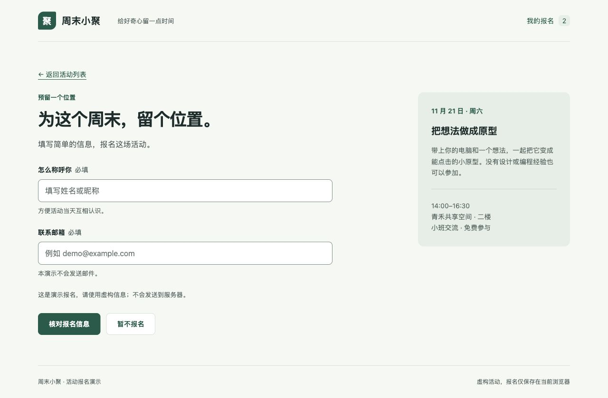
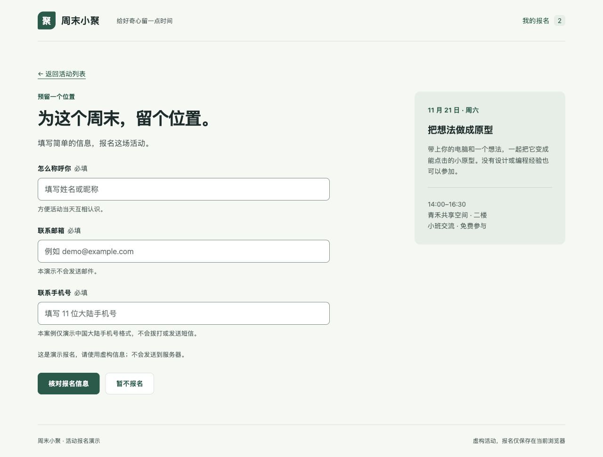
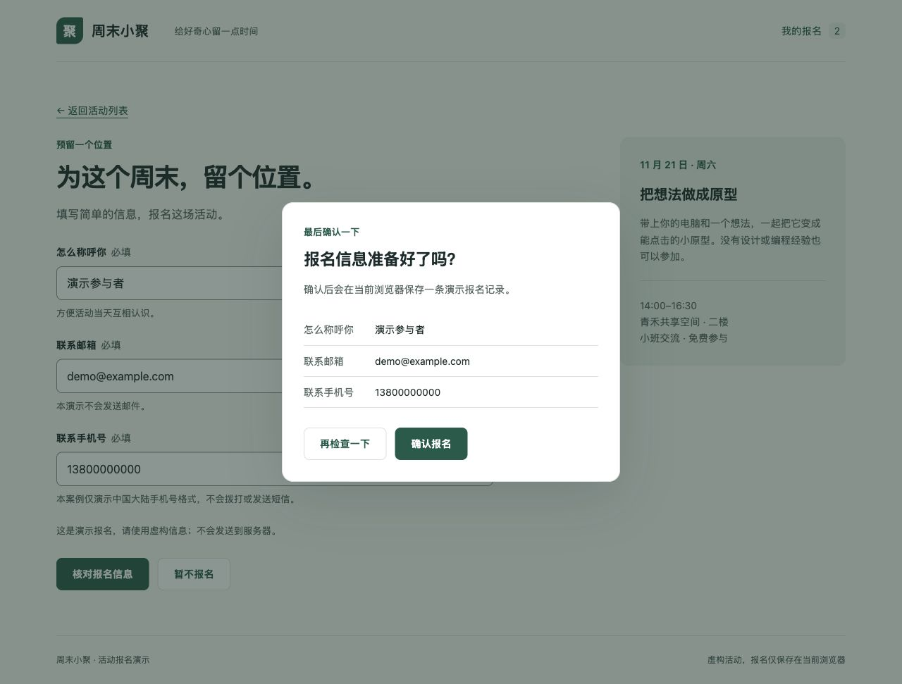
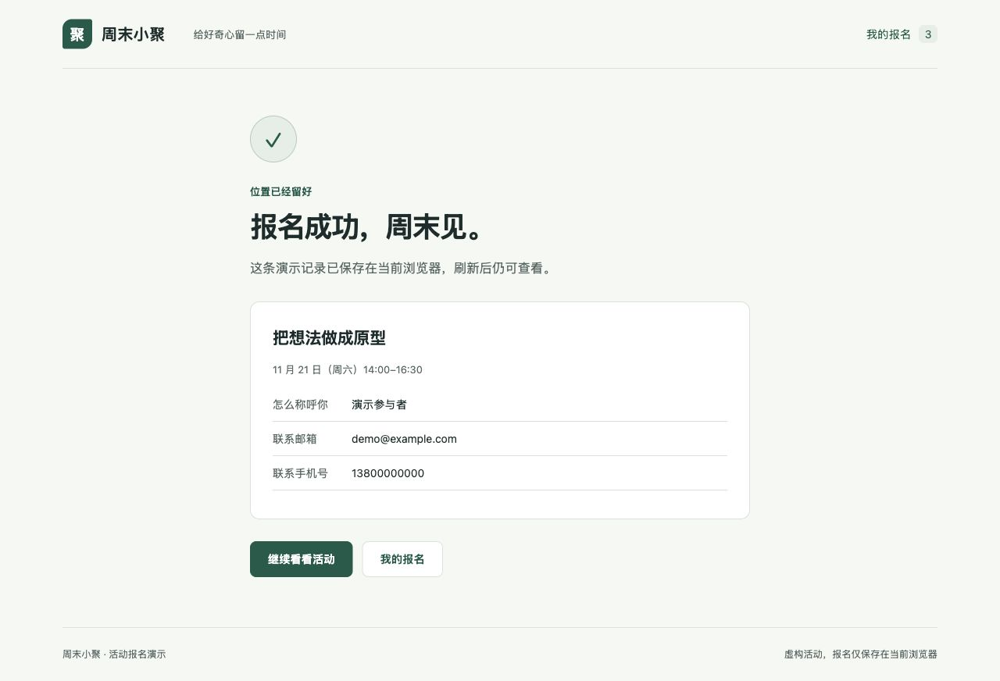
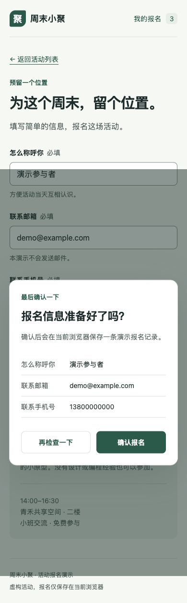
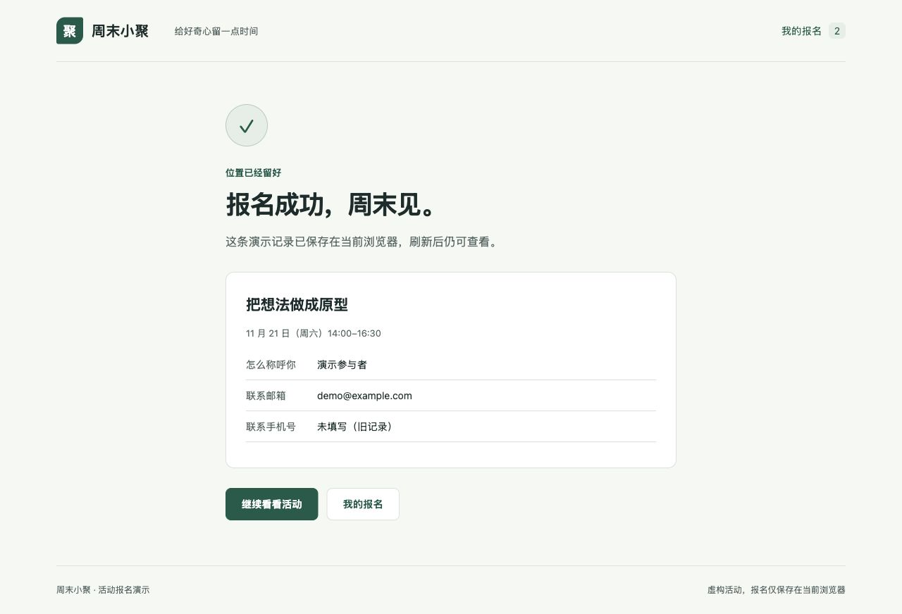

# 从单文件原型到可维护报名流程

修订时间：2026-11-10 13:23:01（Asia/Shanghai）。

这是专门为本仓库构造并执行整理的教学样例，不来自真实业务项目。两个虚构活动共享“活动列表 → 填写报名 → 确认弹窗 → 报名成功”流程。原始版与拆分版支持姓名、邮箱；维护版新增必填手机号。

## 体验与查看

下载仓库 ZIP 并解压，打开 [案例入口 index.html](index.html)。GitHub 文件页展示源码，不直接运行原型。具体打开方式、浏览器存储边界见 [维护说明](README-prototype_20261109-184615.md)。

| 对照阶段 | 产物 | 可检查的结果 |
| --- | --- | --- |
| 原始输入 | `before/index.html`，1 个文件 | 全部界面、样式和脚本集中在一个文件 |
| splitter 整理 | `after-split/`，8 个文件 | HTML 壳、CSS 和有序脚本与原始内容一致；文件职责独立 |
| maintenance 迭代 | `after-change/`，8 个文件 | 新增手机号仅改 `fields.js`、`store.js`；旧记录兼容 |

## 第一阶段：static-prototype-splitter

可以复制给已导入该技能的 Agent；选择技能的入口和专属调用语法以客户端为准。也可以先明确提供对应 `SKILL.md` 的实际路径，让有文件访问能力的 Agent 读取后执行：

```text
使用 static-prototype-splitter，整理 before/index.html 中的活动报名原型。
提取公共样式、活动数据、字段、页面模板、确认弹窗、存储和路由入口。
采用无需框架的静态组件化结构，保留所有现有界面、文案、hash 路由和交互。
保持经典脚本的加载顺序，使 after-split/index.html 可直接打开。
保留原始文件，说明入口、文件职责、数据边界和实际验证结果。
```

本样例选择经典脚本和单一预览入口，因此拆分后的“页面”是 `pages.js` 内的页面模板，而非三个独立 HTML。这个选择用于兼容直接打开文件，并避免维护第二份完整预览。小样例没有为了目录层级继续拆出多个只有几行的页面模块。

`tests/verify.py` 逐字比较原始内联 CSS 与提取后的 CSS，逐字比较原始内联脚本与按相同顺序组合的提取脚本，并比较移除资源声明后的 HTML 壳。它证明本样例的提取一致性；视觉和交互另行验收。

## 第二阶段：prototype-maintenance

```text
使用 prototype-maintenance，基于 after-split 生成 after-change。
新报名增加一个必填的中国大陆手机号字段，检查 11 位格式。
在确认弹窗和成功详情中展示这个字段；不发送短信或邮件。
保留相同存储键和已有记录，不覆盖旧数据，不强制旧记录补填手机号。
把功能改动限制在字段定义与存储白名单中，复用现有页面和弹窗。
补充维护说明、CHANGE-MAP 和实际验证结果。
```

实际代码差异只有两个文件，见 [补丁](phone-field_20261109-175441.patch)。表单、确认和成功详情共用字段元数据，避免为新增字段再维护三套展示代码。

## 可重复的验收流程

1. 打开原始版，填写演示姓名与 `demo@example.com`；打开确认弹窗，取消并检查没有报名记录。
2. 重新确认，检查进入成功页；刷新，检查记录仍在；返回列表，查看报名数量。
3. 在拆分版重复上述流程，比较桌面界面和交互。
4. 在维护版留空手机号或填写 `12345`，检查出现具体错误且不能打开确认弹窗。
5. 用演示号码 `13800000000` 提交，检查弹窗和成功页展示号码，刷新后保留。
6. 反复返回列表、进入报名，确认点击一次只保存一条；检查 Escape 和浏览器前进/后退。
7. 使用测试夹具读取旧记录，检查原始字段不变；新增一条带手机号的记录，检查旧记录没有被覆盖。

执行结果与尚未覆盖的范围见 [VALIDATION](VALIDATION_20261109-184615.md)。源码和截图的作用是让读者检查这个案例，不构成对任意原型、全部浏览器或所有 agent 客户端的保证。

## 下一次修改

例如“增加公司名称”：先在 `fields.js` 定义字段与校验，再在 `store.js` 明确持久化规则，然后验证旧数据、确认弹窗和成功页。常见需求可直接查 [CHANGE-MAP](CHANGE-MAP_20261109-184615.md)。

## 浏览器实测对照

截图来自本案例在同一浏览器中的实际运行，全部信息均为虚构。桌面表单截图中的报名数量保持一致，便于比较原始版与拆分版。

| 原始单文件 | 拆分后（界面保持一致） |
| --- | --- |
|  |  |

维护版增加手机号，确认弹窗和成功详情自动复用字段定义：







| 窄屏表单（390 px） | 窄屏确认弹窗 |
| --- | --- |
|  |  |


